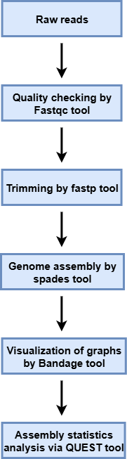
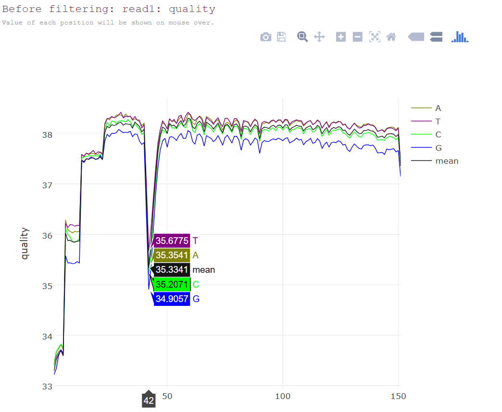
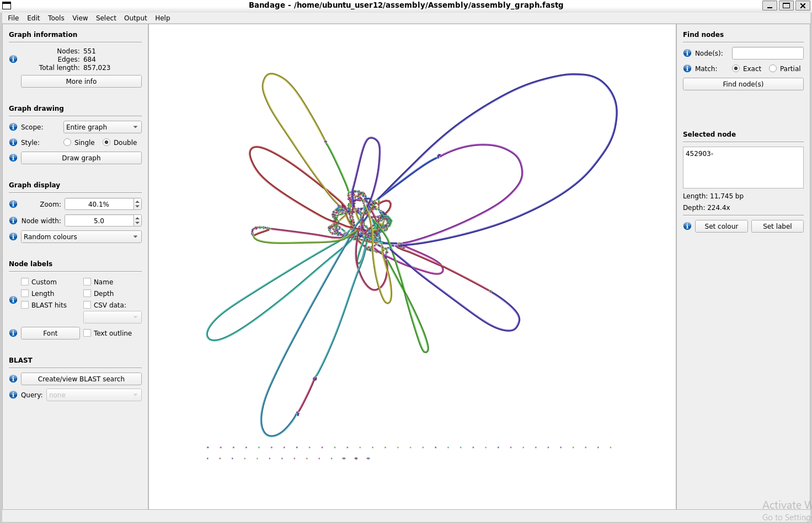

<p align="center">
  
</p>

<h1>🧬Whole-Genome Assembly and Quality Assessment of Mycoplasma pneumoniae</h1>

<h3>A Linux-Based Bioinformatics Pipeline for Bacterial Genome Assembly Using Illumina MiSeq Sequencing Data</h3>

<p align="center">
  
  
  
  
  
  
</p>

---

<p>
  <i>A whole-genome assembly and quality assessment project using Illumina MiSeq sequencing data from Mycoplasma pneumoniae. The workflow covers raw read preparation, quality assessment, adapter trimming, de novo genome assembly, and assembly evaluation, with Bandage used to visualize the resulting assembly graph.</i>
</p>

---

<h2>📑 Table of Contents</h2>

<ul>
  <li><a href="#project-overview">Project Overview</a></li>
  <li><a href="#research-question">Research Question</a></li>
  <li><a href="#project-status">Current Project Status</a></li>
  <li><a href="#dataset">Dataset</a></li>
  <li><a href="#objectives">Objectives</a></li>
  <li><a href="#repository-structure">Repository Structure</a></li>
  <li><a href="#installation">Installation</a></li>
  <li><a href="#requirements">Tools and Requirements</a></li>
  <li><a href="#project-workflow">Project Workflow</a></li>
  <li><a href="#pipeline-steps">Pipeline Steps</a></li>
  <li><a href="#filtering-results">Before and After Filtering</a></li>
  <li><a href="#assembly-results">Genome Assembly Results</a></li>
  <li><a href="#quality-assessment">Assembly Quality Assessment</a></li>
  <li><a href="#bandage-visualization">Bandage Graph Visualization</a></li>
  <li><a href="#future-work">Future Work</a></li>
  <li><a href="#references">References</a></li>
  <li><a href="#license">License</a></li>
  <li><a href="#author-contact">Author and Contact</a></li>
</ul>

---

<h2 id="project-overview">📖 Project Overview</h2>

<p>Whole-genome assembly is an important step in bacterial genomics, where sequencing reads are computationally reconstructed into longer genomic sequences. The quality of the resulting assembly depends on read quality, preprocessing, and the assembly process.</p>

<p>This project implements a Linux-based whole-genome assembly pipeline for <i>Mycoplasma pneumoniae</i> using publicly available Illumina MiSeq sequencing data.</p>

<p>The workflow starts with raw sequencing data and proceeds through quality assessment, adapter trimming, de novo assembly, and assembly evaluation. SPAdes was used to assemble the processed reads, while QUAST provided assembly statistics. Bandage was used to visualize the assembly graph and examine its connectivity.</p>

<p><b>Project focus:</b> To reconstruct the <i>Mycoplasma pneumoniae</i> genome from Illumina sequencing reads and assess the quality and structure of the resulting assembly.</p>

---

<h2 id="research-question">🔬 Research Question</h2>

<p><b>How do read preprocessing and de novo assembly of Illumina MiSeq data contribute to the reconstruction of the Mycoplasma pneumoniae genome, and what do assembly quality metrics and graph-based visualization reveal about the resulting genome assembly?</b></p>

<p>This question guided the read preprocessing, de novo assembly, and quality assessment stages of the project.</p>

---

<h2 id="project-status">🚀 Current Project Status</h2>

<ul>
  <li>✔ Sequencing data retrieval</li>
  <li>✔ SRA to FASTQ conversion</li>
  <li>✔ Raw read quality assessment using FastQC</li>
  <li>✔ Adapter trimming and quality filtering using fastp</li>
  <li>✔ De novo genome assembly using SPAdes</li>
  <li>✔ Assembly evaluation using QUAST</li>
  <li>✔ Assembly graph visualization using Bandage</li>
  <li>✔ Assembly statistics and results summary</li>
</ul>

<badge color="success">Core assembly workflow completed</badge>

---

<h2 id="dataset">📂 Dataset</h2>

<p>The project uses publicly available Illumina sequencing data from <i>Mycoplasma pneumoniae</i>.</p>

<table>
  <tr>
    <th>Component</th>
    <th>Description</th>
  </tr>
  <tr>
    <td>Organism</td>
    <td><i>Mycoplasmoides pneumoniae</i></td>
  </tr>
  <tr>
    <td>Strain</td>
    <td>FH_USA_MA_2009</td>
  </tr>
  <tr>
    <td>Sequencing Platform</td>
    <td>Illumina MiSeq</td>
  </tr>
  <tr>
    <td>Library Type</td>
    <td>Long-insert shotgun, paired-end</td>
  </tr>
  <tr>
    <td>SRA Accession</td>
    <td><a href="https://www.ncbi.nlm.nih.gov/sra/?term=SRR3924617">SRR3924617</a></td>
  </tr>
  <tr>
    <td>Sequencing Spots</td>
    <td>Approximately 1.36 million</td>
  </tr>
  <tr>
    <td>Total Bases</td>
    <td>Approximately 393 Mb</td>
  </tr>
  <tr>
    <td>Download Size</td>
    <td>Approximately 183 MB</td>
  </tr>
  <tr>
    <td>Final Output</td>
    <td>Genome assembly, QUAST reports, and assembly graph visualization</td>
  </tr>
</table>

---

<h2 id="objectives">🎯 Objectives</h2>

<p>The main objectives of this project were to:</p>

<ul>
  <li>Retrieve and prepare publicly available Illumina sequencing data.</li>
  <li>Assess raw read quality before assembly.</li>
  <li>Remove adapters and filter low-quality reads.</li>
  <li>Perform de novo genome assembly using SPAdes.</li>
  <li>Evaluate assembly quality using QUAST statistics.</li>
  <li>Visualize assembly graph connectivity using Bandage.</li>
  <li>Compare sequencing read quality before and after filtering.</li>
  <li>Summarize genome assembly characteristics and identify areas for further analysis.</li>
</ul>

---

<h2 id="repository-structure">📁 Repository Structure</h2>

<p>The repository separates sequencing data, quality reports, processed reads, assembly outputs, and visualization files.</p>

```bash
mycoplasma-assembly-pipeline/
│
├── Data/
│   └── # Raw sequencing data (.sra and FASTQ)
│
├── Quality/
│   └── # FastQC quality reports
│
├── Trimmed/
│   └── # fastp processed reads
│
├── Assembly/
│   └── # SPAdes contigs, scaffolds, and logs
│
├── QUAST/
│   └── # Assembly quality reports
│
├── Bandage/
│   └── # Assembly graph visualization
│
├── Documents/
│   └── # Workflow flowchart and project figures
│
├── Script/
│   └── # Pipeline scripts
│
├── README.md
└── LICENSE
```

---

<h2 id="installation">⚙️ Installation</h2>

<p>Clone the repository:</p>

```bash
git clone https://github.com/genome-miner/mycoplasma-assembly-pipeline.git

cd mycoplasma-assembly-pipeline
```

<p>Download and prepare the sequencing data using the SRA Toolkit.</p>

<p>Install the required bioinformatics tools through Conda:</p>

```bash
conda install -c bioconda sra-tools fastqc fastp spades quast
```

<p>Run the pipeline scripts from the Script directory:</p>

```bash
cd Script
```

<p>Refer to the individual script commands and configuration before execution.</p>

---

<h2 id="requirements">📦 Tools and Requirements</h2>

<p>The pipeline uses the following tools for sequencing data preparation, genome assembly, and quality assessment.</p>

<table>
  <tr>
    <th>Tool</th>
    <th>Purpose</th>
  </tr>
  <tr>
    <td>SRA Toolkit</td>
    <td>Retrieval and conversion of SRA sequencing data into FASTQ format.</td>
  </tr>
  <tr>
    <td>FastQC</td>
    <td>Quality assessment of raw sequencing reads.</td>
  </tr>
  <tr>
    <td>fastp</td>
    <td>Adapter trimming and quality filtering.</td>
  </tr>
  <tr>
    <td>SPAdes</td>
    <td>De novo genome assembly from sequencing reads.</td>
  </tr>
  <tr>
    <td>QUAST</td>
    <td>Evaluation of genome assembly quality and statistics.</td>
  </tr>
  <tr>
    <td>Bandage</td>
    <td>Visualization and examination of assembly graphs.</td>
  </tr>
  <tr>
    <td>Bash</td>
    <td>Command-line scripting and workflow automation.</td>
  </tr>
</table>

---

<h2 id="project-workflow">🔄 Project Workflow</h2>

<p>The complete workflow follows a sequence of read preparation, genome assembly, and quality assessment steps.</p>

<p align="center">
  
</p>

---

<h2 id="pipeline-steps">⚙️ Pipeline Steps</h2>

<p>The analysis follows six main stages:</p>

<ol>
  <li>Retrieve sequencing data and convert SRA files into FASTQ format.</li>
  <li>Assess raw read quality using FastQC.</li>
  <li>Trim adapters and filter reads using fastp.</li>
  <li>Assemble the genome using SPAdes.</li>
  <li>Evaluate assembly statistics using QUAST.</li>
  <li>Visualize the assembly graph using Bandage.</li>
</ol>

---

<h2 id="filtering-results">🧹 Before and After Filtering</h2>

<p>FastQC and fastp were used to examine raw sequencing quality and prepare the reads for genome assembly. The following figures show the before and after filtering results.</p>

<h3>Before Filtering</h3>

<p align="center">
  
</p>

<h3>After Filtering</h3>

<p align="center">
  
</p>

---

<h2 id="assembly-results">📊 Genome Assembly Results</h2>

<p>SPAdes generated the genome assembly, and QUAST was used to summarize its main assembly statistics.</p>

<table>
  <tr>
    <th>Assembly Metric</th>
    <th>Result</th>
  </tr>
  <tr>
    <td>Contigs (≥500 bp)</td>
    <td><b>14</b></td>
  </tr>
  <tr>
    <td>Total Contigs</td>
    <td>15</td>
  </tr>
  <tr>
    <td>Largest Contig</td>
    <td>324,076 bp</td>
  </tr>
  <tr>
    <td>Total Assembly Length</td>
    <td>799,172 bp</td>
  </tr>
  <tr>
    <td>GC Content</td>
    <td>39.78%</td>
  </tr>
  <tr>
    <td>N50</td>
    <td>92,062 bp</td>
  </tr>
  <tr>
    <td>N75</td>
    <td>62,710 bp</td>
  </tr>
  <tr>
    <td>L50</td>
    <td>2</td>
  </tr>
  <tr>
    <td>L75</td>
    <td>5</td>
  </tr>
  <tr>
    <td>N's per 100 kbp</td>
    <td>0.00</td>
  </tr>
</table>

<p><b>Assembly summary:</b> The final assembly contained 15 contigs, including 14 contigs of at least 500 bp, with a total assembly length of 799,172 bp and an N50 of 92,062 bp.</p>

---

<h2 id="quality-assessment">📈 Assembly Quality Assessment</h2>

<p>QUAST was used to evaluate the assembled genome based on contiguity, sequence length, GC content, and the presence of ambiguous bases.</p>

<p>Key observations include:</p>

<ul>
  <li>The largest contig measured 324,076 bp.</li>
  <li>The N50 value was 92,062 bp.</li>
  <li>The assembly GC content was 39.78%.</li>
  <li>No ambiguous bases were reported per 100 kbp.</li>
</ul>

<p>These metrics provide an overview of assembly continuity and sequence composition.</p>

---

<h2 id="bandage-visualization">🧬 Bandage Graph Visualization</h2>

<p>Bandage was used to visualize the assembly graph generated by SPAdes after graph simplification.</p>

<table>
  <tr>
    <th>Graph Metric</th>
    <th>Value</th>
  </tr>
  <tr>
    <td>Nodes</td>
    <td>551</td>
  </tr>
  <tr>
    <td>Edges</td>
    <td>684</td>
  </tr>
  <tr>
    <td>Total Graph Length</td>
    <td>857,023 bp</td>
  </tr>
</table>

<p>The graph provides a visual representation of connections between assembled sequences and helps examine possible repeats and unresolved regions.</p>

<p align="center">
  
</p>

---

<h2 id="future-work">🚀 Future Work</h2>

<p>Further analysis could extend this assembly workflow into functional and comparative genomics.</p>

<ul>
  <li><b>Genome Annotation:</b> Predict genes, proteins, and functional elements using tools such as Prokka.</li>
  <li><b>Comparative Genomics:</b> Compare the assembled genome with reference strains to investigate sequence differences.</li>
  <li><b>Phylogenomic Analysis:</b> Examine the evolutionary relationships with related strains and species.</li>
  <li><b>Pipeline Extension:</b> Adapt the workflow for additional bacterial and viral genome datasets.</li>
</ul>

---

<h2 id="references">📚 References</h2>

<ul>
  <li><b>NCBI SRA:</b> <a href="https://www.ncbi.nlm.nih.gov/sra/?term=SRR3924617">SRR3924617 sequencing dataset</a>.</li>
  <li><b>SRA Toolkit:</b> <a href="https://github.com/ncbi/sra-tools">NCBI SRA Toolkit</a>.</li>
  <li><b>FastQC:</b> <a href="https://www.bioinformatics.babraham.ac.uk/projects/fastqc/">Sequencing quality assessment</a>.</li>
  <li><b>fastp:</b> <a href="https://github.com/OpenGene/fastp">Read preprocessing and filtering</a>.</li>
  <li><b>SPAdes:</b> <a href="https://github.com/ablab/spades">Genome assembly software</a>.</li>
  <li><b>QUAST:</b> <a href="https://github.com/ablab/quast">Genome assembly evaluation</a>.</li>
  <li><b>Bandage:</b> <a href="https://github.com/rrwick/Bandage">Assembly graph visualization</a>.</li>
</ul>

---

<h2 id="license">📄 License</h2>

<p>This project is licensed under the <a href="https://github.com/genome-miner/mycoplasma-assembly-pipeline/blob/main/LICENSE">MIT License</a>.</p>

---

<h2 id="author-contact">👩‍💻 Author and Contact</h2>

**Sana Aziz Sial**  
Biotechnologist and Bioinformatician
- 🎓 [University of Veterinary and Animal Sciences](https://www.uvas.edu.pk/)
- 📧 [Email](sanaazizsial@gmail.com)
- 🐙 [GitHub](https://github.com/genome-miner)
- 🔗 [LinkedIn](in/sana-aziz-sial-73b189265)

<p><i>Open to research collaboration, feedback, and opportunities to learn.</i></p>

---

<p align="center">
  
</p>
